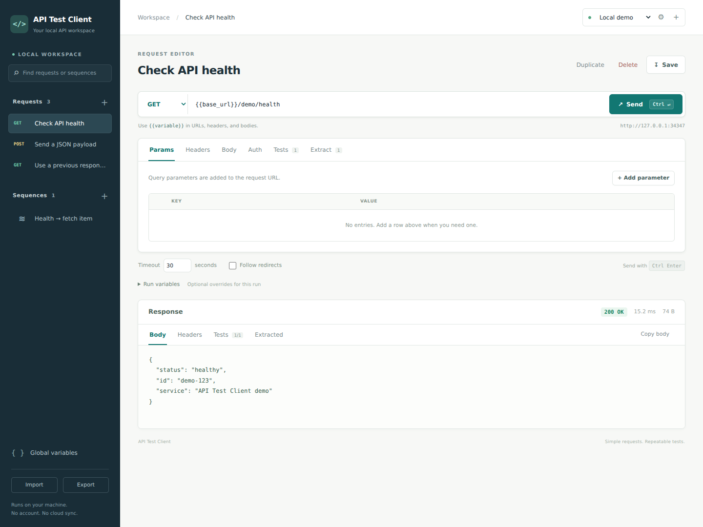

# API Test Client

A lightweight API client for testing endpoints, switching between environments,
managing API keys and variables, and running request sequences.

The interface runs in your browser, with a local Python server handling HTTP
requests. Python 3.11 or newer is the only runtime requirement. There is no cloud
account, telemetry, or JavaScript build step.



## Get started

Clone the repository and start the application:

**Windows**

```powershell
git clone https://github.com/UALR-CORE-Center/api-test-client.git
cd api-test-client
py -m api_test_client
```

**macOS / Linux**

```sh
git clone https://github.com/UALR-CORE-Center/api-test-client.git
cd api-test-client
python3 -m api_test_client
```

Your browser opens at **http://127.0.0.1:8765**. Leave the terminal running while
you use the application; press **Ctrl+C** to stop it.

The initial workspace includes a local demo environment and requests for the
built-in mock API. Send the health request or echo request to try the client
without an external service or API key.

Optional installation:

```sh
python -m pip install .
api-test-client
```

On Windows, use `py` in place of `python`; on macOS/Linux, use `python3` if needed.

## What it does

- Save environments with a base URL, authentication, and variables.
- Build requests with query parameters, headers, and JSON, text, or form bodies.
- Inspect response status, headers, body, and elapsed time.
- Check responses with assertions and extract values for later requests.
- Run ordered sequences with per-step variable overrides and optional stopping
  when a step fails.
- Save your workspace locally and import or export it.
- Run saved sequences from the command line for repeatable checks.

## Environments and variables

Create an environment for each context, such as Local, Staging, and Production.
Select the environment before sending a request or running a sequence. Requests
use the selected environment's base URL and credentials.

Authentication options are:

| Mode | Behavior |
| --- | --- |
| None | Send no generated authentication. |
| Bearer | Set the `Authorization: Bearer …` header. |
| API key header | Send a key in a configurable header. |
| API key query | Send a key in a configurable query parameter. |
| Basic | Send an HTTP Basic username and password. |

Requests inherit environment authentication by default. Override authentication
on an individual request when an endpoint needs different credentials.

Reference variables with `{{name}}` in URLs, headers, query values, and bodies.
For example:

```text
{{base_url}}/assets/{{asset_id}}
```

Global variables supply defaults. Environment variables override globals, and
runtime variables override environment values. The environment also exposes
`{{base_url}}` and `{{api_key}}`; these built-ins take precedence over variables
with the same names. Extracted values can be passed to subsequent sequence steps;
a step's variable overrides apply to that step and override extracted values.

Mark credential variables as **secret** so they are removed from workspace
exports. For JSON bodies, substituted values must still produce valid JSON;
place quotes around string placeholders where needed.

## Requests and response checks

Use a relative URL such as `/assets` to use the current environment's base URL,
or enter a complete `http://` or `https://` URL. Enable or disable individual
query and header rows without deleting them.

Supported body types are **None**, **JSON**, **Text**, and **Form**. Form bodies
use `application/x-www-form-urlencoded` encoding.

TLS certificates are verified. Redirect following is disabled by default; when
enabled, redirects are limited to the same scheme, host, and port. Response
bodies are capped at 2 MiB, and a truncated response is reported as a failed
request.

Assertions run against the response:

| Assertion | What it checks |
| --- | --- |
| `status` | HTTP status equals the expected code. |
| `json_equals` | A JSON path equals the expected value. |
| `json_exists` | A JSON path exists. |
| `body_contains` | The response body contains text. |
| `header_equals` | A response header equals the expected value. |
| `time_below` | Response time is below a threshold in milliseconds. |

A request passes when its response is successful, all assertions pass, and all
extractors succeed. Add a status assertion to test an expected error response,
such as HTTP 404; a matching expected status can make that request pass.

JSON paths support object fields and array indexes, for example `$.id` and
`$.assets[0].name`. These are simple paths; wildcard matching, filters, and
recursive JSONPath expressions are outside this version's scope.

Define an extractor with a variable name and JSON path to reuse a response
value. For example, extract `$.id` as `asset_id`, then use `{{asset_id}}` in the
next request.

## Sequences

A sequence is an ordered list of saved requests. A typical sequence might:

1. Create an asset and check for the expected status.
2. Extract its ID from the response.
3. Fetch `/assets/{{asset_id}}` and verify its fields.
4. Delete `/assets/{{asset_id}}`.

Select an environment, choose the requests, and add any per-step variable
overrides. Turn on **stop on failure** when later steps should depend on earlier
success. Cancellation takes effect between requests; an in-flight request must
finish or time out before the run stops.

## Command-line runs

Run a saved sequence by its ID or name:

```sh
python -m api_test_client run --sequence "Asset lifecycle" --environment Staging
```

Supply runtime variables or use a different workspace:

```sh
python -m api_test_client run --workspace ./workspace.local.json \
  --sequence "Asset lifecycle" --environment Staging \
  --var asset_name=test-asset --var expected_status=201 \
  --output ./reports/asset-lifecycle.json
```

The multiline example uses a Unix shell. On Windows, place the command on one
line, or use PowerShell's backtick line continuation.

The command prints a JSON report. Exit codes are **0** for success, **1** for a
failed run, and **2** for invalid command arguments. Reports redact known secret
values by default. Use `--show-secrets` only when you need unredacted output, and
keep that output private. Response bodies may contain sensitive data unrelated
to saved secret variables, so review reports before sharing them.

Use `python -m api_test_client --help` or
`python -m api_test_client run --help` for available options.

## Server and workspace options

```sh
python -m api_test_client serve --port 9000 --no-browser
python -m api_test_client --workspace ./workspace.local.json
```

The server binds to `127.0.0.1`. It is intended for local use and should not be
exposed through a public proxy or hosted as a shared service. Requests are sent
by your local Python process, so the client can reach services accessible from
your computer without browser CORS restrictions.

The default workspace is `~/.api-test-client/workspace.json`. Set
`API_TEST_CLIENT_WORKSPACE` or pass `--workspace` to choose another path. The
command-line option takes precedence over the environment variable. Keep
separate workspace files when you want independent collections or projects.

Workspace changes persist locally, including credentials. Workspace files are
**plaintext**: POSIX systems use owner-only file permissions, and Windows relies
on the file's OS access controls. Never commit a workspace containing live
credentials. Workspaces are limited to 4 MiB.

Workspace export removes authentication secrets, secret-marked variables, and
authentication-sensitive headers. Exported request bodies and arbitrary values
can still contain secrets, so review the file before sharing it. Import only
workspaces you trust, and review request URLs before executing them.

## Development

Run tests from the repository root:

```sh
python -m unittest discover -s tests -v
```

Tests use local mock endpoints. CI runs the suite on Windows and Linux with
Python 3.11 and 3.13. See [CONTRIBUTING.md](CONTRIBUTING.md) for development
guidelines.

## Scope

This first release focuses on ordinary HTTP API requests. Multipart uploads,
interactive OAuth login flows, WebSockets, and arbitrary scripted hooks are not
included. Use variables or bearer authentication for tokens obtained elsewhere.

Licensed under the [MIT license](LICENSE).
